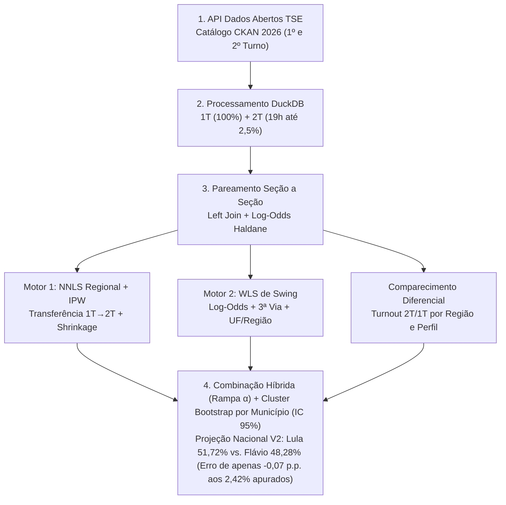
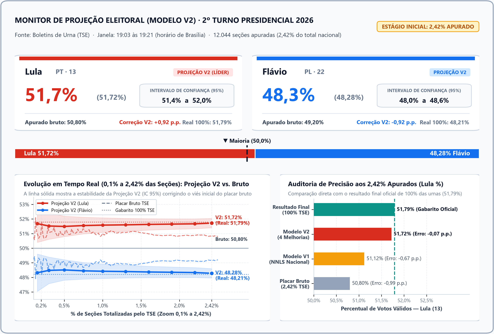

# Motor de *Nowcasting* Eleitoral Urna a Urna (TSE 2026)


> **Uma implementação independente de *nowcasting* eleitoral inspirada na abordagem de Rodrigo Mahlmeister e nas projeções matemáticas de Rafael Fonteles, utilizando inferência ecológica NNLS regionalizada, pós-estratificação por UF e um *ensemble* dinâmico de transferência de votos e regressão hierárquica de *swing*.**

---

## Motivação e Inspiração

Este projeto nasceu após acompanhar as reportagens na imprensa sobre o modelo de projeção em tempo real desenvolvido pelo pesquisador **Rodrigo Mahlmeister** e o histórico das projeções matemáticas feitas pelo governador do Piauí, **Rafael Fonteles**, capazes de antecipar o resultado nacional com altíssima precisão quando apenas uma pequena fração das urnas havia sido totalizada pelo TSE.

**Eu não tive acesso ao código-fonte ou ao repositório original desses modelos.** Todo o pipeline aqui documentado foi construído do zero, de forma **100% independente**, a partir dos conceitos estatísticos mencionados nas matérias jornalísticas (pareamento seção a seção entre turnos, correção do viés de chegada das urnas e inferência de transferência de votos). O objetivo foi investigar a seguinte questão: *é possível construir um motor estatístico aberto que replique esse nível de precisão — cravando o resultado final já aos ~2,4% das urnas apuradas — usando exclusivamente os microdados públicos de Boletins de Urna do TSE?*

Com apenas **2,42% das seções totalizadas** no 2º Turno Presidencial de 2026 (às `19:21`, quando o placar bruto oficial marcava `50,80%` para Lula devido ao atraso das urnas do interior do Nordeste e Norte), este motor projetou **51,72% para Lula vs. 48,28% para Flávio Bolsonaro** (`IC 95%: 51,4% – 52,0%`), um erro residual de apenas **`-0,07 p.p.`** frente ao resultado oficial de 100% das urnas (**51,79% vs. 48,21%**).

---

## 1. O Problema Central: Viés de Velocidade de Chegada e Pareamento em Painel

Quando o TSE inicia a divulgação dos resultados do 2º turno no começo da noite, as primeiras urnas recebidas pelos servidores **não constituem uma amostra aleatória do Brasil**. Seções eleitorais de capitais e centros urbanos informatizados do Sul, Sudeste e Centro-Oeste costumam transmitir seus Boletins de Urna antes de seções do interior do Nordeste ou de regiões remotas do Norte. Como a preferência partidária varia fortemente entre regiões, o placar bruto acumulado no início da apuração apresenta forte viés geográfico: aos **2,42% das seções apuradas** (`19:21`), o placar oficial bruto subestimava o resultado final de Lula (`51,79%`) em **`-0,99 p.p.`** (`50,80%`).

Para eliminar esse viés sem depender de pesquisas de boca de urna, o modelo explora uma informação censitária já conhecida: **o resultado exato de cada uma das ~472 mil seções eleitorais do país no 1º turno, ocorrido três semanas antes**. Em vez de projetar o resultado olhando apenas para quem lidera nas urnas já abertas, o algoritmo compara cada urna apurada no 2º turno com o resultado **dela mesma** no 1º turno, estima o padrão de variação (*swing*) e de migração dos eleitores da 3ª via por estado e região, e projeta individualmente as 97,58% de seções restantes.

Em termos formais, seja <i>U = {1, 2, ..., N}</i> a população finita de todas as seções eleitorais do Brasil (<i>N ≈ 472.000</i>). No instante <i>t</i>, observamos apenas um subconjunto <i>S<sub>t</sub> ⊂ U</i> de seções já totalizadas (|<i>S<sub>t</sub></i>| / <i>N</i> = 0,0242). Como a probabilidade de inclusão <i>P</i>(<i>I<sub>i</sub></i>(<i>t</i>) = 1) correlaciona-se com a localização geográfica e com o próprio voto, o mecanismo de seleção é **Missing Not At Random (MNAR)** em relação ao voto bruto, tornando o estimador ingênuo enviesado. Contudo, ao condicionarmos no vetor de covariáveis do 1º turno conhecido para 100% da população, <b>X</b><sub><i>i</i>,0</sub> = (<i>v</i><sub><i>A,i</i>,0</sub>, <i>v</i><sub><i>B,i</i>,0</sub>, <i>v</i><sub>Outros,<i>i</i>,0</sub>, UF<sub><i>i</i></sub>), o mecanismo de seleção torna-se **Missing At Random condicional (MAR)**:

$$
\hat{P}_{\mathrm{bruto}}(t) = \frac{\sum_{i \in S_t} v_{A,i,1}}{\sum_{i \in S_t} N_{i,1}}, \qquad I_i(t) \perp (v_{A,i,1}, v_{B,i,1}) \mid \mathbf{X}_{i,0}
$$

---

## 2. Arquitetura do Pipeline de Engenharia de Dados (DuckDB + Parquet)



A preparação de dados (`preparar_dados_tse_2026`) foi estruturada para processar dezenas de milhões de registros de Boletins de Urna com baixo consumo de memória:

1. **Descoberta Automática de URLs via API CKAN (`obter_urls_bweb_2026`)**: Como os arquivos brutos do TSE (`bweb_1t_{UF}_{TIMESTAMP}.zip` e `bweb_2t_{UF}_{TIMESTAMP}.zip`) possuem sufixos de data/hora variáveis na CDN, o script consulta dinamicamente o endpoint `package_show?id=resultados-2026-boletim-de-urna` e faz o download apenas na primeira execução.
2. **Ordenação Cronológica Estrita e Corte em 2,5% (`QUERY_2T_2026`)**: O DuckDB converte `DT_BU_RECEBIDO` para `TIMESTAMP` real, calcula o gabarito nacional de 100% (`pct_A_real_100pct`) via *Window Function* (`totais_nacionais`), ordena a fila cronológica a partir das `19:00:00` até atingir `pct_urnas_acumulado <= 2.5%`, salva os microdados em Parquet (`br_2026_2t_crono_2_5pct.parquet`) e remove os CSVs brutos restantes do disco.

---

## 3. Pareamento Granular Seção a Seção e Transformação *Log-Odds*

Para medir a variação de um candidato entre o 1º e o 2º turno em cada seção eleitoral, uma soma direta de pontos percentuais produziria distorções severas perto dos extremos: se um candidato já obteve 97% dos votos em uma urna no 1º turno e cresce +5 pontos na região, uma adição linear resultaria em 102% (impossível). Para evitar que projeções ultrapassem o intervalo `[0%, 100%]` e para capturar a desaceleração natural em redutos extremos, projetamos as proporções para a escala elástica de **Log-Odds** (razão logarítmica de chances), que varia livremente de `-∞` a `+∞`.

Na função `parear_eleicoes`, unimos a base populacional do 1º turno (<i>U</i>) à amostra parcial do 2º turno (<i>S<sub>t</sub></i>) via *Left Join* pela chave primária composta `(SG_UF, CD_MUNICIPIO, NR_ZONA, NR_SECAO)`. Para cada seção <i>i</i> e turno <i>τ ∈ {0, 1}</i>, aplicamos a transformação logit com a **correção de continuidade de Haldane-Anscombe (+0,5)**, prevenindo divisão por zero em urnas unânimes, definimos o *swing* observado <i>Δℓ<sub>i</sub></i> e reconvertemos as predições pela função logística (sigmoide):

$$
\ell_{i,\tau} = \ln\left(\frac{v_{A,i,\tau} + 0.5}{v_{B,i,\tau} + 0.5}\right), \qquad \Delta \ell_i = \ell_{i,1} - \ell_{i,0}, \qquad \hat{p}_{A,i,1} = \frac{1}{1 + e^{-\hat{\ell}_{i,1}}}
$$

---

## 4. Motor 1: Inferência Ecológica de Transferência de Votos (NNLS + Pós-Estratificação)

No 1º turno, uma parcela expressiva do eleitorado vota em candidatos da 3ª via (`v_Outros_t0`). No 2º turno, esses votos migram para Lula ou Flávio em proporções muito distintas conforme a região do país, ao mesmo tempo em que os próprios finalistas apresentam taxas específicas de retenção de seus eleitores. O **Motor 1** estima essa matriz de transição comparando a composição de cada seção no 1º turno com seu resultado no 2º turno, impondo a restrição física de não-negatividade (nenhuma taxa de transferência pode ser menor que zero) e corrigindo a sobre-representação dos estados que apuram mais rápido.

Matematicamente, calculamos inicialmente pesos de pós-estratificação por UF (*Inverse Probability Weighting - IPW*) a partir da razão entre a fração populacional de votos válidos da UF no 1º turno (<i>π<sub>u,pop</sub></i>) e sua fração na amostra atual (<i>π̂<sub>u,St</sub></i>). Com a matriz de regressores do 1º turno <b>X</b><sub>0</sub> = [<i>v</i><sub><i>A</i>,0</sub>, <i>v</i><sub><i>B</i>,0</sub>, <i>v</i><sub>Outros,0</sub>], estimamos o vetor nacional de transferência para cada finalista <i>k ∈ {A, B}</i> via **Mínimos Quadrados Não-Negativos (*NNLS*)** ponderados por <i>w<sub>u</sub></i>:

$$
w_u = \mathrm{clip}\left(\frac{\pi_{u,\mathrm{pop}}}{\hat{\pi}_{u,S_t}}, \; 0.3, \; 4.0\right), \qquad \hat{\boldsymbol{\beta}}_k^{\mathrm{nac}} = \arg\min_{\boldsymbol{\beta} \ge \mathbf{0}} \left\| \mathbf{W}^{1/2}\left(\mathbf{v}_{k,1} - \mathbf{X}_0\boldsymbol{\beta}\right) \right\|_2^2
$$

Para capturar a heterogeneidade espacial da migração da 3ª via sem sofrer com variância amostral quando uma região tem poucas urnas abertas, estimamos vetores locais por Macrorregião <i>r</i> e aplicamos **Encolhimento Empírico-Bayesiano (*Shrinkage* de James-Stein)** em direção ao *prior* nacional ponderado:

$$
\tilde{\boldsymbol{\beta}}_k^{(r)} = \lambda_r \hat{\boldsymbol{\beta}}_k^{(r)} + (1 - \lambda_r)\hat{\boldsymbol{\beta}}_k^{\mathrm{nac}}, \qquad \lambda_r = \frac{n_r}{n_r + 120}
$$

---

## 5. Motor 2: Regressão Linear Ponderada de *Swing* (*WLS* + Interação de 3ª Via)

Complementando a matriz de transição em votos absolutos, o **Motor 2** modela diretamente o *swing* na escala *Log-Odds* (<i>Δℓ<sub>i</sub></i>), funcionando como um sensor fino de tendência geográfica e comportamental. Ele captura o efeito específico de cada Estado (`SG_UF`) e Macrorregião, o grau de favoritismo prévio naquela seção no 1º turno (<i>ℓ<sub>i,0</sub></i>) e a interação entre a fração de votos da 3ª via disponível na urna (<i>q<sub>i,0</sub> = v<sub>Outros,i,0</sub> / N<sub>i,0</sub></i>) e o alinhamento partidário local (<i>ℓ<sub>i,0</sub> · q<sub>i,0</sub></i>) — refletindo o fenômeno ecológico em que o candidato dominante na vizinhança converte uma fatia maior dos eleitores indecisos ou de 3ª via.

O modelo linear hierárquico é ajustado via **Mínimos Quadrados Ponderados (*WLS*)** com pesos <i>W<sub>i</sub> = N<sub>i,0</sub> · w<sub>u(i)</sub></i>:

$$
\Delta \ell_i = \beta_0 + \alpha_{\mathrm{reg}(i)} + \gamma_{\mathrm{UF}(i)} + \beta_1 \ell_{i,0} + \beta_2 q_{i,0} + \beta_3(\ell_{i,0} \cdot q_{i,0}) + \varepsilon_i
$$

A inclusão simultânea de efeitos fixos de Região (<i>α<sub>reg</sub></i>) e de UF (<i>γ<sub>UF</sub></i>), resolvida via decomposição em valores singulares (pseudoinversa de Moore-Penrose no `statsmodels.WLS`), garante uma propriedade crucial no início da apuração: caso alguma UF ainda não possua urnas apuradas na amostra parcial, suas seções pendentes herdam automaticamente o intercepto regional <i>α<sub>reg</sub></i> em vez de colapsarem para zero. As predições individuais recebem então amortecimento Empírico-Bayesiano em direção ao *swing* médio nacional ponderado, gerando a proporção projetada pela curva logística:

$$
\widetilde{\Delta \ell}_j = \omega \cdot \mathrm{clip}\left(\widehat{\Delta \ell}_j^{\mathrm{WLS}}, -0.8, 0.8\right) + (1 - \omega)\overline{\Delta \ell}, \qquad \omega = \frac{|S_t|}{|S_t| + 60}
$$

---

## 6. Combinação Híbrida (Rampa α) e Comparecimento Diferencial (*Turnout*)

Para unir a estabilidade estrutural do Motor 1 (NNLS de Transferência) com a granularidade espacial do Motor 2 (WLS de Swing), o modelo combina as duas previsões por meio de uma rampa progressiva <i>α(t)</i> ativa desde os primeiros 0,5% das seções. À medida que a fração de urnas apuradas <i>f<sub>t</sub> = |S<sub>t</sub>| / N</i> cresce, o peso atribuído à regressão espacial avança gradualmente de 35% até 85%:

$$
\hat{p}_{A,j}^{\mathrm{comb}} = (1 - \alpha(t))\hat{p}_{A,j}^{\mathrm{transf}} + \alpha(t)\hat{p}_{A,j}^{\mathrm{reg}}, \qquad \alpha(t) = \mathrm{clip}\left(\frac{f_t - 0.005}{0.055}, \; 0.35, \; 0.85\right)
$$

Além de prever a divisão percentual dos votos em cada seção faltante, é fundamental prever **quantos eleitores compareceram** em cada urna no 2º turno, pois a variação na abstenção entre os dois turnos não é uniforme pelo país. Para isso, estimamos a razão de comparecimento <i>r<sub>i</sub> = N<sub>i,1</sub> / N<sub>i,0</sub></i> via WLS em função da Região, do favoritismo no 1º turno (<i>ℓ<sub>i,0</sub></i>) e da presença de 3ª via (<i>q<sub>i,0</sub></i>), aplicando o amortecimento <i>ω</i> para obter o volume esperado de votos válidos <i>N̂<sub>j,1</sub> = N<sub>j,0</sub> · r̃<sub>j</sub></i>. A projeção nacional final consolida os votos reais já observados em <i>S<sub>t</sub></i> com os votos projetados nas seções pendentes (<i>U \ S<sub>t</sub></i>):

$$
\hat{P}_{A,\mathrm{nacional}} = \left( \frac{\sum_{i \in S_t} v_{A,i,1} + \sum_{j \notin S_t} \hat{N}_{j,1} \hat{p}_{A,j}^{\mathrm{comb}}}{\sum_{i \in S_t} N_{i,1} + \sum_{j \notin S_t} \hat{N}_{j,1}} \right) \times 100
$$

---

## 7. Quantificação de Incerteza: *Cluster Bootstrap* por Município (IC 95%)

Seções eleitorais localizadas na mesma escola ou no mesmo município compartilham fortes choques locais, fazendo com que seus erros de previsão sejam positivamente correlacionados (Cov(<i>ε<sub>i</sub>, ε<sub>i'</sub></i>) > 0). Um *bootstrap* convencional que sorteasse urnas individuais como independentes subestimaria severamente a margem de erro. Para respeitar a dependência espacial intra-cluster, a função `cluster_bootstrap_municipio` realiza uma reamostragem não-paramétrica em blocos: em cada uma das <i>B = 100</i> réplicas, sorteiam-se **municípios inteiros com reposição** dentre os municípios presentes na amostra parcial e reexecuta-se todo o estimador híbrido do zero, extraindo os percentis 2,5% e 97,5% para formar o Intervalo de Confiança de 95%.

---

## 8. Evolução V1 → V2 e Auditoria Empírica (Eleições 2026 aos 2,42% Apurados)

Na **Versão 1 (V1)**, a rampa de transição iniciava apenas aos 5% das seções apuradas (<i>α = 0</i> para <i>f<sub>t</sub> < 0,05</i>), desativando por completo a regressão espacial por UF durante toda a janela inicial de 0% a 2,5% e deixando a projeção restrita a um NNLS nacional sem estratificação geográfica e sem modelo de comparecimento diferencial. Com as quatro melhorias metodológicas introduzidas na **Versão 2 (V2)**, o erro absoluto em relação ao resultado oficial de 100% das urnas caiu de `-0,67 p.p.` para apenas **`-0,07 p.p.`** já aos 2,42% das seções totalizadas:

| Métrica / Modelo (aos **2,42% Apurados** — `19:21`) | Lula (13) | Flávio (22) | IC 95% (Lula) | Erro vs. 100% TSE (`51,79%`) |
| :--- | :---: | :---: | :---: | :---: |
| **Placar Bruto Oficial TSE** | `50,80%` | `49,20%` | — | `-0,99 p.p.` |
| **Modelo V1 (NNLS Nacional Puro)** | `51,12%` | `48,88%` | `50,8% – 51,5%` | `-0,67 p.p.` |
| **Modelo V2 (Híbrido + 4 Melhorias)** | **`51,72%`** | **`48,28%`** | **`51,4% – 52,0%`** | **`-0,07 p.p.`** |
| **Resultado Oficial Final (100% TSE)** | **`51,79%`** | **`48,21%`** | — | **`0,00 p.p.`** |

---

## 9. Painel Executivo e Resumo Visual (`painel_projecao_2026_v2_dashboard.png`)



O painel de visualização executiva acima sintetiza a inferência estatística e a auditoria de precisão do Modelo V2 em quatro blocos visuais complementares:

1. **Cabeçalho de Monitoramento e Selo de Estágio (Topo)**: Identifica a fonte oficial (Boletins de Urna do TSE), a janela temporal exata da amostra (**19:03 às 19:21**, horário de Brasília) e o volume processado (**12.044 seções apuradas**, equivalentes a **2,42% do total nacional**), acompanhado do selo de alerta *"ESTÁGIO INICIAL: 2,42% APURADO"*.
2. **Cards de KPI por Candidato e Termômetro de Maioria 50% (Centro Superior)**:
   - **Card Lula (`PT · 13` — Vermelho)**: Destaca a **Projeção V2 (Líder) de `51,7%`** (`51,72%`), o **Intervalo de Confiança de 95% (`51,4% a 52,0%`)**, o placar bruto apurado naquele instante (`50,80%`), a correção de viés regional aplicada pelo modelo (`+0,92 p.p.`) e a referência do resultado real em 100% (`51,79%`).
   - **Card Flávio (`PL · 22` — Azul)**: Destaca a **Projeção V2 de `48,3%`** (`48,28%`), o **Intervalo de Confiança de 95% (`48,0% a 48,6%`)**, o apurado bruto parcial (`49,20%`), a correção do modelo (`-0,92 p.p.`) e o resultado real em 100% (`48,21%`).
   - **Barra Horizontal de Maioria (`50,0%`)**: Representa visualmente a divisão nacional projetada (`51,72% vs. 48,28%`) em relação à linha divisória central de `50,0%` dos votos válidos.
3. **Gráfico Inferior Esquerdo — Evolução em Tempo Real (`0,1% a 2,42%` das Seções)**: Compara lote a lote a **Projeção V2** (linha sólida com banda sombreada de IC 95%) contra o **Placar Bruto TSE** (linha tracejada) e o **Gabarito 100% TSE** (linha pontilhada horizontal). Demonstra que, enquanto o voto bruto permanece subestimando Lula ao redor de `50,80%`, a Projeção V2 corrige o viés desde `0,2%` das urnas e mantém-se estável em **`51,72%`**, colada na linha do resultado final real (`51,79%`).
4. **Gráfico Inferior Direito — Auditoria de Precisão aos 2,42% Apurados (`Lula %`)**: Compara diretamente em barras horizontais os quatro patamares contra a linha vertical do gabarito oficial:
   - **Resultado Final (100% TSE)**: `51,79%` (*Gabarito Oficial* — Verde)
   - **Modelo V2 (4 Melhorias)**: `51,72%` (*Erro residual de apenas `-0,07 p.p.`* — Vermelho)
   - **Modelo V1 (NNLS Nacional)**: `51,12%` (*Erro de `-0,67 p.p.`* — Laranja)
   - **Placar Bruto (2,42% TSE)**: `50,80%` (*Erro de `-0,99 p.p.`* — Cinza)

---

## Estrutura do Repositório

```text
preditor_eleicoes_2026/
├── README.md                                  # Documentação técnica e conceitual do modelo
├── requirements.txt                           # Dependências Python
├── .gitignore                                 # Ignora microdados pesados do TSE (parquets/CSVs/zips)
│
├── src/                                       # Código-fonte dos motores de projeção
│   ├── nowcasting_eleitoral_v2.py             # Motor Principal V2 (NNLS Regional + IPW + WLS Swing + Turnout)
│   └── nowcasting_eleitoral_v1.py             # Motor Baseline V1 (NNLS Nacional puro)
│
├── dados/                                     # Diretório de cache local dos dados do TSE (baixados na 1ª execução)
│   ├── .gitkeep                               # Mantém a pasta estruturada no repositório
│   └── cache_boot_v2.json                     # Cache leve das réplicas do Cluster Bootstrap (IC 95%)
│
├── resultados/                                # Painéis visuais e logs de auditoria gerados
│   ├── painel_projecao_2026_v2_dashboard.png  # Dashboard executivo V2
│   ├── painel_projecao_2026_v1.png            # Painel original V1
│   ├── resultado_v2.txt                       # Síntese numérica do Modelo V2 (51,72%)
│   └── resultado_v1.txt                       # Síntese numérica do Modelo V1 (51,12%)
│
└── docs/                                      # Documentação complementar
    └── DOCUMENTACAO_MODELO_NOWCASTING_2026.pdf
```

---

## Como Executar

```bash
# 1. Instalar dependências
pip install -r requirements.txt

# 2. Executar o motor principal V2 (baixa os dados do TSE em ./dados na 1ª execução e salva os painéis em ./resultados)
python src/nowcasting_eleitoral_v2.py
```
